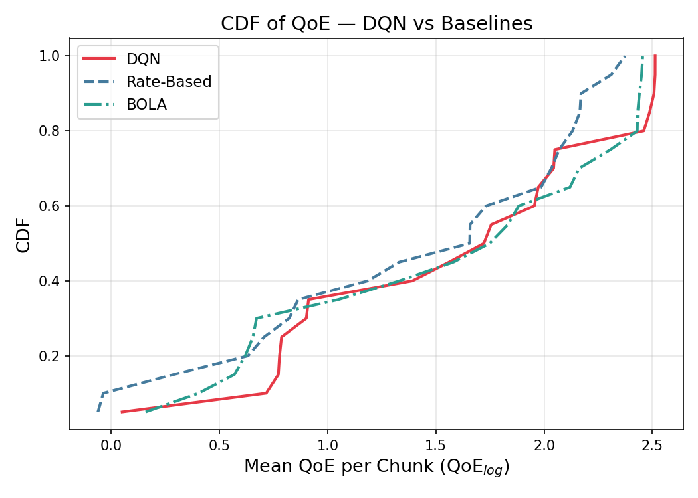
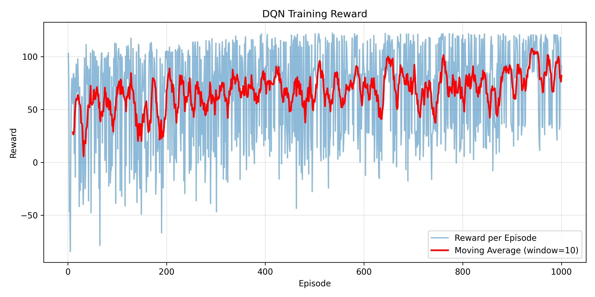

# DQN for Adaptive Bitrate Streaming

A Double DQN agent that picks the bitrate of each video chunk in an HLS-style player, compared against two classic ABR baselines: **BOLA** (buffer-based, Lyapunov) and a **rate-based** throughput heuristic. The environment and QoE metric follow the setup of [Pensieve](https://github.com/hongzimao/pensieve) (Mao et al., SIGCOMM 2017).

## Setup

- **Environment** (`video_env.py`): chunk-level simulator driven by real network traces; 6 bitrate levels (300–4300 kbps).
- **State**: 6 features × last 8 chunks (throughput, download time, next chunk sizes, buffer level, chunks left, last bitrate).
- **Reward**: log-QoE per chunk, `log(R/R_min) − 2.66·rebuffer − |log(R_n) − log(R_{n−1})|`.
- **Agent** (`dqn_agent.py`): Double DQN in PyTorch with experience replay (`replay_buffer.py`) and a target network.
- **Traces** (`generate_traces.py`): synthetic lognormal bandwidth traces with random drops. Training uses 90 traces (30 weak, 30 medium, 30 strong). Testing uses 20 separate traces drawn with a different seed and random mean and variance. `traces/` also includes Pensieve's scripts for the FCC and Norway datasets.

## Results

20 test traces, trained for 1000 episodes (`results/summary.txt`):

| Algorithm | Mean QoE | Avg bitrate (kbps) | Rebuffer | Switches |
|---|---|---|---|---|
| **DQN** | **1.643** | **2582** | 1.49% | **7.8** |
| BOLA | 1.563 | 2517 | **0.56%** | 19.9 |
| Rate-based | 1.370 | 1865 | 0.59% | 8.8 |

DQN gets the highest mean QoE with the fewest bitrate switches, but it is more aggressive than both baselines and rebuffers about 2.5–2.7× as often. These numbers come from one training run on synthetic traces, so they are not a statistically robust comparison and have not been tested on real network traces.

<p>
  
  
</p>

## Running

```bash
pip install -r requirements.txt

python train.py                                   # train (resumes from models/ if a checkpoint exists)
python evaluate.py --traces_dir traces/test --model_path models/dqn_model.pth
python demo.py                                    # run the trained agent on one trace
```

## Layout

```text
train.py, dqn_agent.py, replay_buffer.py   DQN training
video_env.py, load_trace.py                simulator and trace loader
bola_agent.py, rate_based_agent.py         baselines
evaluate.py, plot.py, plot_training.py     evaluation and figures
models/                                    trained checkpoints
results/                                   metrics, summary and plots
traces/                                    train / test network traces
```
